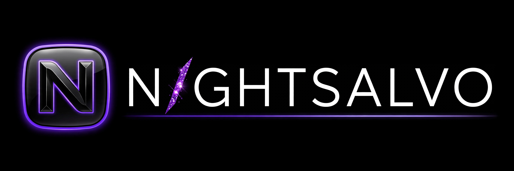
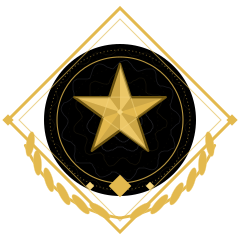
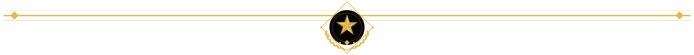
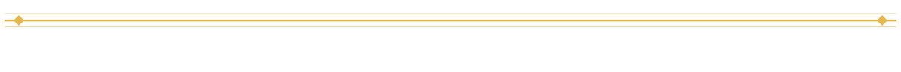
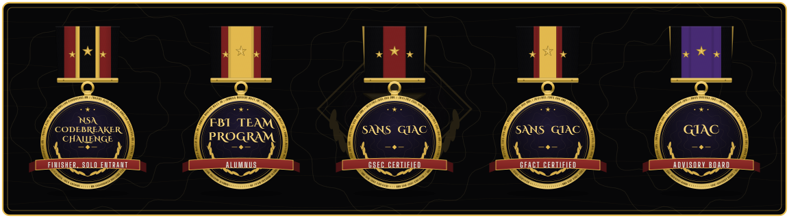
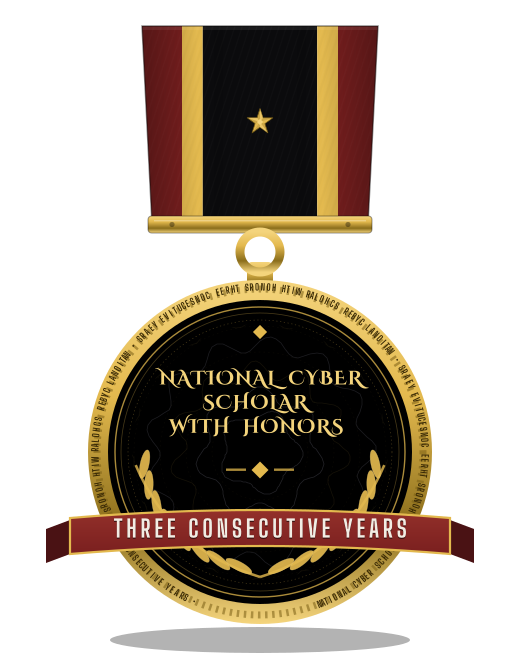
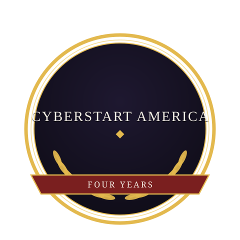
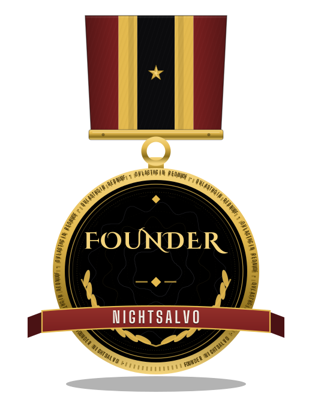
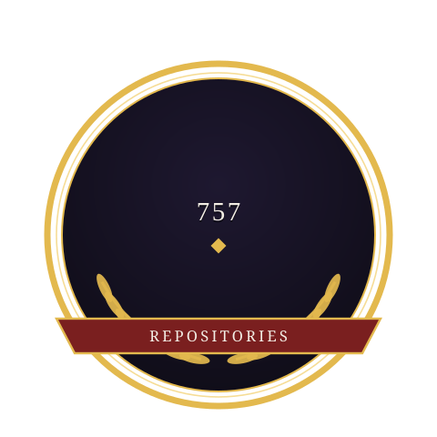

# NightSalvo

*Night falls. Threats end.*

Original security-systems engineering. In active development.

What is being built:

- An autonomous planner that decomposes an engagement into verifiable steps
- An enforced scope guard that keeps every action inside written authorisation
- A hash-chained evidence ledger, so findings cannot be quietly rewritten
- An audit-first design: every claim in a report traces back to evidence

Founder: Gavin Blacklock (Gavin K.) ([@Epsilon0xCell](https://github.com/Epsilon0xCell))

## NightSalvo, In Short

One founder. One record. Nobody else fields this combination: GIAC certifications with an Advisory Board seat, a solo finish in the NSA Codebreaker Challenge, and a 584-project security library I built and then audited line by line. The fleet stands at 757 repositories; 754 of them were audited line by line in the final verification, and zero live secrets were found.

The founder's standing: National Cyber Scholar with Honors, three years running, a title earned by 600 of 30,000 students who seek to qualify, the top 2% of the national cybersecurity student funnel. He attained the CyberStart America maximum score of 147,600 in three consecutive program years. An assessment of the record models the 88th percentile of all participants in cybersecurity, and a modeled 76th percentile among working professionals alone.

Open to founding engagements: repository security audits, security reviews of small codebases, hardening reviews, and research engagements. The route in is my GitHub profile: https://github.com/Epsilon0xCell

## The Evidence

| Measure | Count |
|---|---|
| Repositories in the fleet | 757 |
| Project org library | 584 |
| Audited line by line | 754 |
| Fully themed presentations shipped | 48 |
| Live secrets found in final verification | 0 |

## The Elite Row

Operator-grade work, every claim on this page verifiable.

## The Record

   

